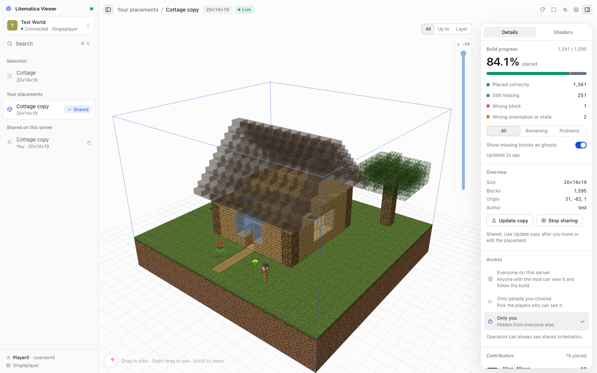

<h1 align="center">Litescape</h1>

<p align="center">Your Litematica selections and schematic placements in 3D, in a browser tab.</p>

<p align="center">
  
  
  
  <a href="LICENSE"></a>
</p>

<picture>
  <source media="(prefers-color-scheme: dark)" srcset="docs/images/viewer-dark.png">
  
</picture>

A Fabric mod for Minecraft 26.3 that shows your Litematica selection and schematic placements as 3D models in a browser tab. It reads [BuildPrint](https://modrinth.com/mod/buildprint) builds the same way. On a server that also runs the mod, players can share a placement so everyone can watch it get built.

## What it does

- Select an area with Litematica's area selection tool and it appears at `http://127.0.0.1:8723/`, with the textures from your current resource pack. The view reloads when you move a corner.
- Open one of your placements to compare it with the world. Correct blocks render normally, missing blocks show as ghosts, a wrong block is tinted red and a wrong orientation or state is tinted amber. A redstone component set up wrong (an observer or hopper facing the wrong way, a repeater on the wrong delay, a comparator in the wrong mode) is tinted purple and counted on its own, so it stands out from cosmetic mistakes like stairs facing the wrong way. The counts and the material list ("88 left") update every 2 seconds.
- Click Share on a placement to upload it to the server. Once you let them in from the Access panel, other players with the mod see it under "Shared on this server" and can follow progress from anywhere. The server compares it against the world using whatever chunks it has loaded. Sharing is opt-in per placement, and only the owner or an operator can stop sharing. When someone else shares a schematic with you, it arrives under "Share requests" first: Accept adds it to your list, Deny hides it. The server remembers your answer. You can still hide an accepted one later, and the header shows how many you've hidden so you can bring them back.
- When you share, you can include the surroundings: the land and builds up to 8, 16 or 32 blocks around the placement. The server copies them from the world once, as a snapshot, and the shared view shows the schematic standing in them. They're greyed out by default so the build stands out; the Surroundings panel switches them to full color or hides them. Chunks the server didn't have loaded show up empty, and the panel says how many. Go near them and press Recapture. Recapture and Update copy take a new snapshot. Build progress still comes from the live world. The surroundings follow the schematic's Access setting.
- Sharing can put the schematic somewhere else: change X, Y and Z under Position and the placement moves there before it uploads. A share carries the Litematica placement too, chests and hoppers included. Players who can see it click Load in Litematica to get it in game at the shared position, with the same rotation, mirror and sub-region settings. The file lands in their `schematics/litescape` folder. In the viewer, hovering over a chest or hopper lists what goes in it. A schematic shared with an older version of the mod needs Update copy before it can be loaded.
- The Access panel sets who can see a shared schematic: everyone on the server, only the players you pick, or only you. A new share starts as only you. Players can be picked while they're online or once they've helped build it. Operators can always see and manage every shared schematic. The server enforces this: a player without access doesn't get the schematic in their list and can't download it or its progress. Update copy keeps the access you set.
- The server switcher at the top of the sidebar lists every server you've joined with the mod. The one you're on is live. The others show what was shared with you on your last visit, and any schematic you opened there can still be viewed in 3D. Progress, placements and access changes need you to be on that server. Joining a server switches the page to it.
- A shared schematic lists its contributors: who placed blocks that match it, how many and when they were last active. Blocks count when a player places them by hand after the schematic was shared; buckets, pistons and commands like `/fill` don't count, and re-placing the same block counts once. Each player shows with their Minecraft face, cropped from their skin. The skin comes from Mojang the same way the game loads skins for player heads; players without one get their default skin. Everyone who can see the shared schematic can see this list. The schematic's author from the Litematica file is shown too.
- BuildPrint works in place of Litematica, or next to it. Its loaded builds in your dimension show under your placements and can be opened, compared and shared like Litematica placements. Its selection shows when Litematica has none. A shared BuildPrint build stays linked to its shared copy by its name and position, so after you rename or move the build, Share makes a new copy.
- The viewer also has layer slicing (all, up to a layer, single layer), hover to identify a block, click to isolate a material, a filter for remaining blocks or problems, screenshots, and a <kbd>⌘K</kbd> command palette. Light and dark themes follow your system.
- The viewer comes in English, German, Spanish, French, Japanese, Korean, Brazilian Portuguese, Russian and Chinese (Simplified and Traditional). It picks your browser's language; to choose another, type the language's name in the command palette. Shader pack settings use the pack's own translation when it has one, and the mod's chat messages follow Minecraft's language setting.

Type `/litweb` in game to open the viewer, or click the link posted in chat when you join a world. If you use the desktop app, these open the app instead of a browser tab.

## Shader packs

The viewer can render with Iris and OptiFine shader packs. Open the Shaders tab in the right panel, or press <kbd>V</kbd>.

- Packs come from your `shaderpacks` folder, the same one Iris uses. If you use Iris, the packs you already have show up, starting from the settings you picked in game.
- If you have none, the tab lists popular packs and downloads the one you pick from Modrinth into that folder.
- Each pack's own settings screens, profiles (Low, High, Ultra and so on) and sliders are there, with search. Changes recompile the pack in a second or two, and the old picture stays up until the new one is ready.
- The Scene controls set the time of day, the weather and the render resolution.

Packs tested so far: Complementary Reimagined and Unbound, BSL, MakeUp Ultra Fast, Sildur's Vibrant, Solas, Super Duper Vanilla and Bliss. Photon runs, but its sky and lighting come out wrong.

How it works: the mod preprocesses a pack the way Iris does, then compiles each program with glslang and converts it to WebGL's GLSL with SPIRV-Cross. Minecraft already ships both. The page then runs the pass chain in WebGL 2: shadow map, gbuffers, deferred, translucent, composite and final.

Browsers can't do everything a desktop GPU can, so some effects are missing:

- Compute shaders, geometry shaders and image storage don't exist in WebGL. Packs that use them for colored block light or voxel effects fall back to their simpler path, and the tab lists anything it had to leave out.
- Only terrain is drawn. There are no entities, hand, clouds, particles or sun and moon sprites.
- Light levels are computed from the blocks in view, and the biome is always plains.
- Resource pack normal and specular maps (LabPBR) aren't loaded yet.

It needs WebGL 2 with floating-point render targets, which current Chrome, Edge, Firefox and Safari all have.

## Install

Install the Litescape app. It finds your Minecraft instances and installs the mod and everything it needs into the ones you pick, or creates a ready-to-play instance for you.

```sh
brew install --cask GA16-24/tap/litescape   # macOS and Linux
```

On Windows, run `Litescape-<version>-win-x64.exe` from the [releases page](https://github.com/GA16-24/homebrew-tap/releases). Linux users without Homebrew can download the `.AppImage` from the same page.

When the game isn't running, the app lists the instances it found in the Minecraft Launcher, Prism Launcher, the Modrinth App and CurseForge. Click Install next to one, then start the game from that instance. If you use another launcher, click "Add instance folder…" and choose the instance's folder.

- Install also downloads Fabric API, MaLiLib and Litematica from Modrinth when the instance doesn't have them, picking the newest Fabric build for that instance's Minecraft version. It's only offered for instances that already run Fabric on Minecraft 26.3.
- "Create Litescape instance" adds a Litescape profile to the Minecraft Launcher, with its own game folder (`litescape` inside the launcher's folder), Fabric Loader, the three mods above and Litescape. Close the Minecraft Launcher first, or it may overwrite the new profile when it exits. Creating it again updates the same profile.
- When you update the app, it updates the mod in every instance that has an older copy the next time it lists them.
- Install removes any other copy of the mod in that instance, so you never end up with two. Remove takes it out again. Close the game in that instance first: Windows won't let the app replace a jar the game has open.
- Minecraft Launcher profiles that share a game folder share its mods folder too, so installing into one puts the mod in all of them.

Once the game is running, the app shows the viewer. If you quit the game it goes back to the instance list, and it reconnects when you start the game again. Links to other sites open in your browser.

After you've opened the app with the game running, `/litweb` and the chat link open the app instead of your browser, starting it if it's closed. If the app doesn't respond within 10 seconds, for example because you uninstalled it, the game opens your browser and goes back to using it. The setting is kept in `config/litweb-desktop-app`.

The macOS build isn't notarized yet. The Homebrew cask clears the download quarantine for you. If you install the `.dmg` by hand, macOS will block the first launch until you allow it under System Settings → Privacy & Security.

### Without the app

The mod also works on its own, with the viewer in a browser tab. Put the jar in your mods folder yourself:

| Where             | Needs                                                                                                                                                                                                                                                                            |
| ----------------- | -------------------------------------------------------------------------------------------------------------------------------------------------------------------------------------------------------------------------------------------------------------------------------- |
| Client            | Fabric Loader 0.20.1+, Fabric API, Litematica 0.29.1 (and MaLiLib) or BuildPrint 0.1.46, this mod                                                                                                                                                                                |
| Server (optional) | On a Fabric server:<br>1. Download the jar from [Modrinth](https://modrinth.com/mod/litescape).<br>2. Put it and [Fabric API](https://modrinth.com/mod/fabric-api) in `mods/`.<br>3. Restart the server.<br>It doesn't need Litematica. See [Server settings](#server-settings). |

It's one jar for both sides. Servers always install it by hand. Without the server part, the client reads blocks from the chunks it has loaded and the page tells you what percentage of the area is covered.

## Server settings

`config/litweb-server.properties` is created on first start:

| Key                     | Default    | Meaning                                                                                                                                                          |
| ----------------------- | ---------- | ---------------------------------------------------------------------------------------------------------------------------------------------------------------- |
| `region-read`           | `ops`      | Who may read areas from the server for the selection view (`ops`, `everyone`, `none`). Everyone else falls back to their own loaded chunks.                      |
| `shared-progress`       | `everyone` | Who may request build progress for shared schematics. Progress reveals whether each position matches, so set `ops` if you worry about players using it to scout. |
| `max-shared-per-player` | `20`       | How many schematics one player can share at once.                                                                                                                |
| `terrain-capture`       | `ops`      | Who may include surroundings when sharing (`ops`, `everyone`, `none`). Surroundings can show ores, bases and other players' builds near the schematic.           |
| `terrain-max-margin`    | `32`       | How many blocks around a schematic the surroundings may reach, up to 64.                                                                                         |

Shared schematics are stored in `<world>/litweb/`, with their surroundings in `<id>.terrain.bin`.

Server reads only touch chunks that are already loaded. They never load or generate terrain, so a far-away selection can't stall the server.

## Privacy and security

The web server binds to `127.0.0.1` only. It rejects requests whose `Host` or `Origin` isn't the local page, so other websites can't read your world or share on your behalf.

The server switcher keeps each server's shared list and the schematics you opened in `~/.litescape/<your player UUID>/`, so every instance you play with the same Minecraft account shares them and other accounts on this computer don't see them. Older versions kept them in each instance's `config/litweb-servers/`; the first launch after updating moves that folder over. A copy is deleted once it's unshared or you lose access and you next visit that server. Surroundings aren't kept in these copies, so they only show while you're on that server. Taking away someone's access doesn't remove a copy they already downloaded.

Opening the Shaders tab asks Modrinth for the popular packs' icons and download counts. Getting a pack downloads it from Modrinth. Nothing else leaves your computer, and these requests carry no account or world details. Shader settings are saved in `config/litweb-shaders.json`.

## Limits

- Views are capped at 16,777,216 blocks (for example 256×256×256). Reads from the world are capped at 4,194,304 blocks because they run on the game thread. That includes surroundings, so a large schematic can only take a small margin; sizes over the cap can't be picked.
- Blocks drawn by special renderers without a block model (chests, signs) show as their outline box in their particle texture.
- Biome tint (grass, leaves, water) is sampled once at the center of the view.
- The selection view refreshes when the selection changes or when you press <kbd>R</kbd>. It doesn't watch for block edits inside an unchanged selection.

## Development

```sh
./gradlew build              # mod jar in build/libs/
./gradlew runClientGameTest  # boots the real client, builds a test house, checks the HTTP API and a small test shader pack end to end
node web-dev/serve.mjs       # web app on :8194 using the fixtures the game test recorded
./gradlew shaderDev -Ppacks=<folder>  # the shader API on :8195 without Minecraft; serve.mjs forwards /api/shaders to it
node web-dev/expr.test.mjs   # custom-uniform expression tests
node web-dev/ui-tokens.test.mjs  # style.css colors come from its tokens; font sizes and radii stay on the scale
cd desktop && npm ci && npm start  # the desktop app; installs the jar from build/libs, so run ./gradlew build first
node --test desktop/instances.test.mjs  # instance detection and install, against fake launcher folders
cd desktop && npm run dist         # desktop installers for this OS in desktop/dist/
```

To release the desktop app, bump `version` in `desktop/package.json`, merge, and push a matching `desktop-v<version>` tag. The Desktop release workflow builds macOS, Windows and Linux, publishes them as a release on the public [GA16-24/homebrew-tap](https://github.com/GA16-24/homebrew-tap) repo and updates the cask there. It needs a `TAP_TOKEN` secret in the `homebrew-tap` environment: a fine-grained token with Contents read and write on that repo. To sign and notarize the macOS app later, remove `identity` and `hardenedRuntime` from `desktop/package.json` and add the [electron-builder signing secrets](https://www.electron.build/code-signing-mac) to the build job.

The game test writes its API responses and textures to `build/run/clientGameTest/litweb-fixtures/`. The dev server replays them and simulates a build in progress, so you can work on the UI without Minecraft running. `/dev?mode=offline|noworld|empty|full` switches between the page's states.

The web app is plain ES modules with a vendored copy of three.js r170 (MIT). It has no build step.

## Acknowledgments

A lot of this project was inspired by [T3 Code](https://github.com/pingdotgg/t3code). The web viewer's look and feel, including its design tokens, light and dark themes and command palette, used T3 Code as the reference for polish.
